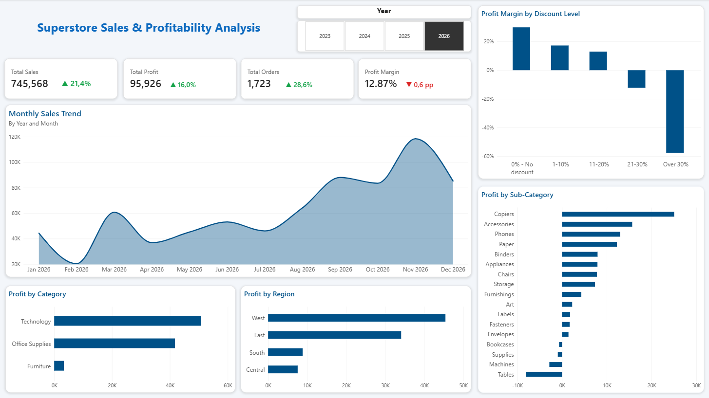

# Superstore Sales & Profitability Analysis

An interactive Power BI dashboard for analyzing retail sales performance, profitability, and discount strategies.



---

## Project Overview

This project analyzes retail transaction data to evaluate business performance across product categories, sub-categories, geographical regions, and discount levels.

The dashboard provides an interactive overview of key business metrics and allows users to investigate year-over-year (YoY) performance changes from 2023 to 2026.

## Business Objectives

- Monitor overall sales, profit, and order performance.
- Analyze monthly sales trends and year-over-year growth.
- Identify the most and least profitable product categories.
- Compare profitability across geographical regions.
- Evaluate the relationship between discount levels and profit margins.

## Tools & Technologies

| Tool | Purpose |
|---|---|
| Power BI | Interactive dashboard and data visualization |
| DAX | Measures, calculated columns, and time-based calculations |
| Power Query | Data preparation and transformation |

## Key Performance Indicators

The dashboard includes the following KPIs:

- Total Sales
- Total Profit
- Total Orders
- Profit Margin
- Sales YoY Growth
- Profit YoY Growth
- Orders YoY Growth
- Profit Margin YoY Change

## Dashboard Features

### 1. KPI Overview

- Four key business performance indicators.
- Dynamic year-over-year comparisons.
- Conditional formatting for positive and negative changes.

### 2. Sales Trend Analysis

- Monthly sales performance.
- Interactive yearly filtering.
- Comparison of annual business performance.

### 3. Profitability Analysis

- Profit by product category.
- Profit by sub-category.
- Profit by geographical region.
- Identification of profitable and unprofitable product segments.

### 4. Discount Analysis

- Profit margin across different discount levels.
- Identification of discount ranges associated with negative profitability.
- Analysis of the relationship between discounting and business performance.

## Key Insights

- Technology is the most profitable product category.
- Tables generate the largest losses among product sub-categories.
- The West and East regions demonstrate the strongest overall profitability.
- Higher discount levels are associated with lower profit margins.
- Discount levels above 30% are associated with substantial negative profitability.

## Dataset

| Attribute | Description |
|---|---|
| Number of records | 10,194 |
| Time period | January 2023 – December 2026 |
| Data type | Retail transaction data |
| Main fields | Orders, sales, profit, discounts, products, and geographical information |

## Repository Structure

```text
superstore-sales-profitability-analysis/
│
├── README.md
├── Superstore_Sales_Profitability_Analysis.pbix
└── dashboard.png
